# Phrasevale — Audio Shadowing

**Local recovery candidate1.0(2), UNSUBMITTED.** The last verified Apple version1.0(1) was rejected under Guideline4.3(a); a clarification was sent. Lifetime Pro was Ready for Review. The current candidate has not been uploaded, resubmitted, approved or released. Apple authentication and remaining production checks are pending.

Built by **Sepideh Javanbakht Dalir** · [arvinify.com](https://www.arvinify.com) · [hello@arvinify.com](mailto:hello@arvinify.com)

## A complete personal audio practice session

Bring audio you own, save short source-relative phrases, and work through a focused sequence: listen with a speaking pause, speak aloud, optionally record your response, compare the source followed by your voice, then reflect on one detail. Mark phrases “Needs another try” or “Comfortable for now,” retain personal notes, revisit unfinished phrases and resume the last phrase.

The assessments belong to the learner. There is no automatic speech scoring, transcription, licensed lesson library, actor-role reader or cloud service. All session tools are free within one source. The existing one-time Lifetime Pro expands the source library, named collections and saved presets. Existing audio, purchases and portable backups remain supported.

## Current native campaign

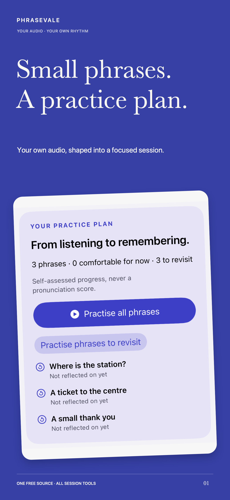 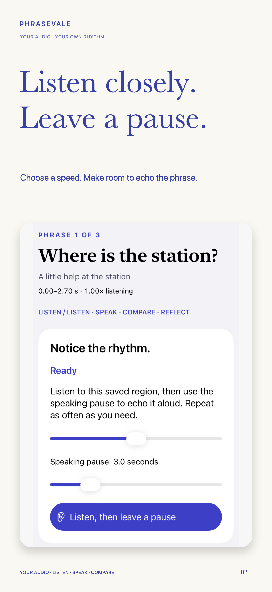 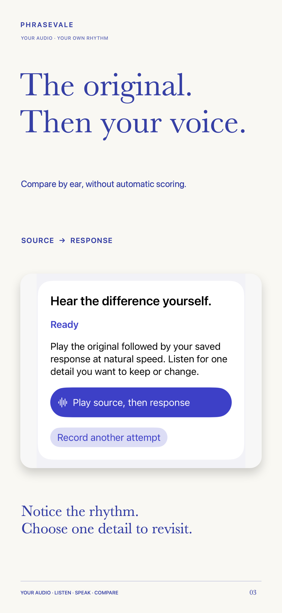 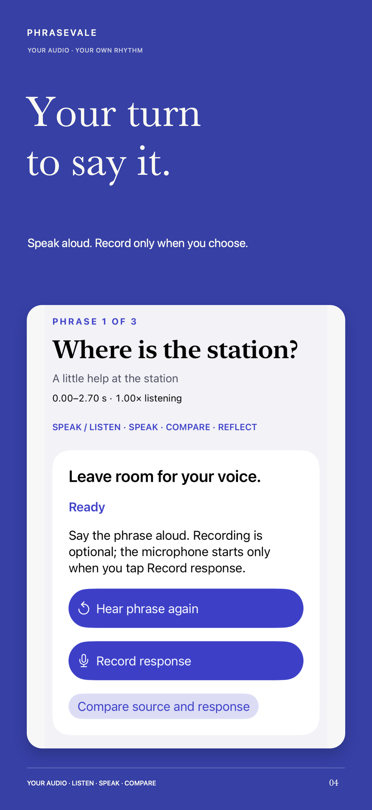 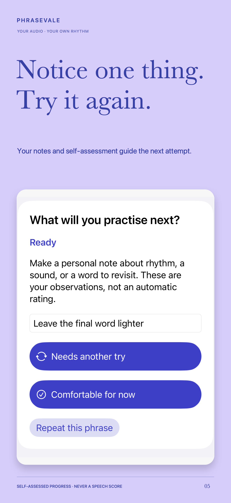 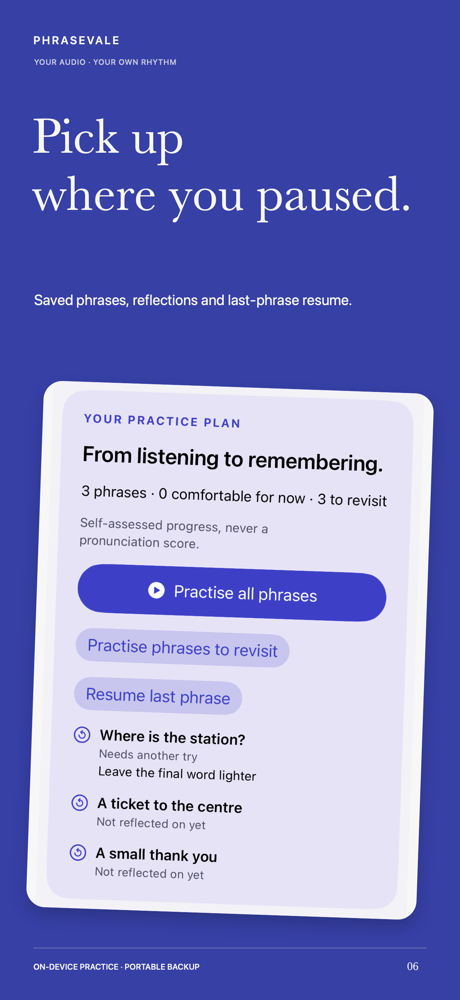 

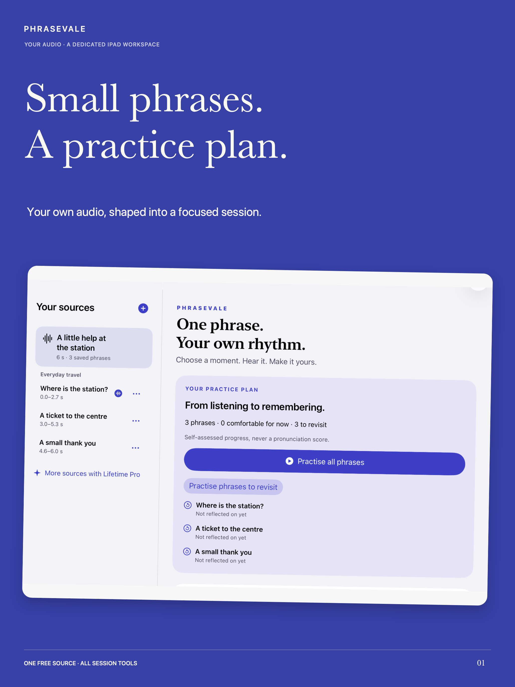 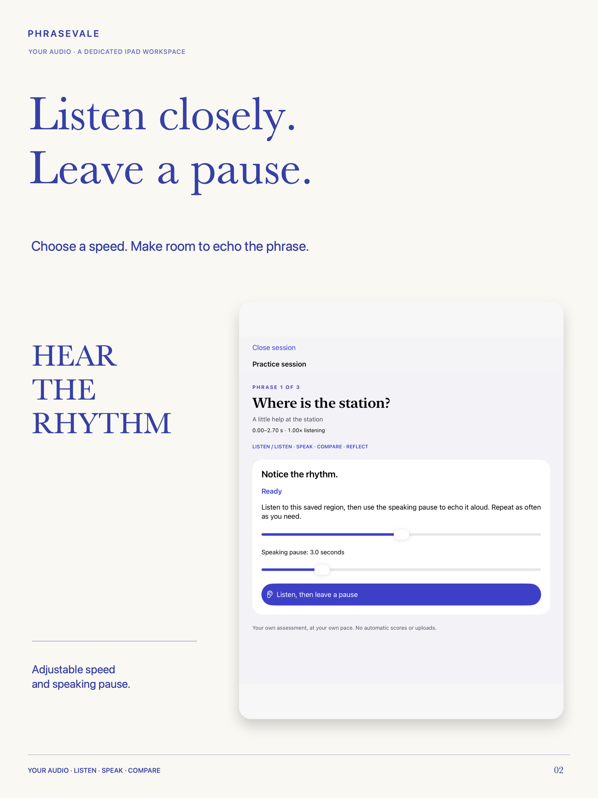 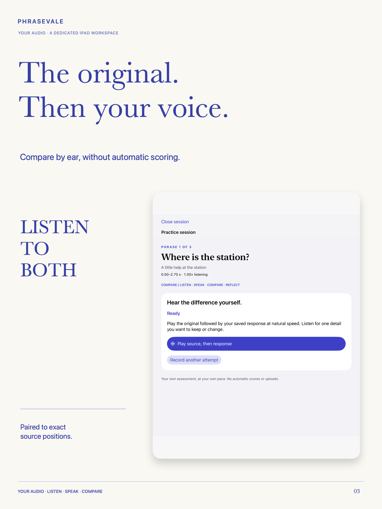 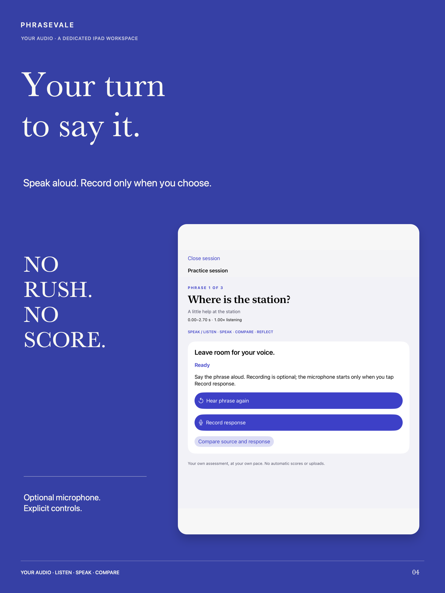 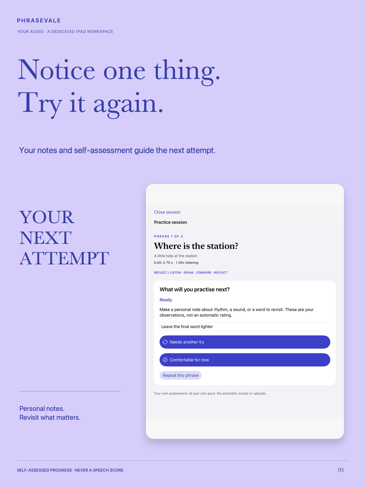 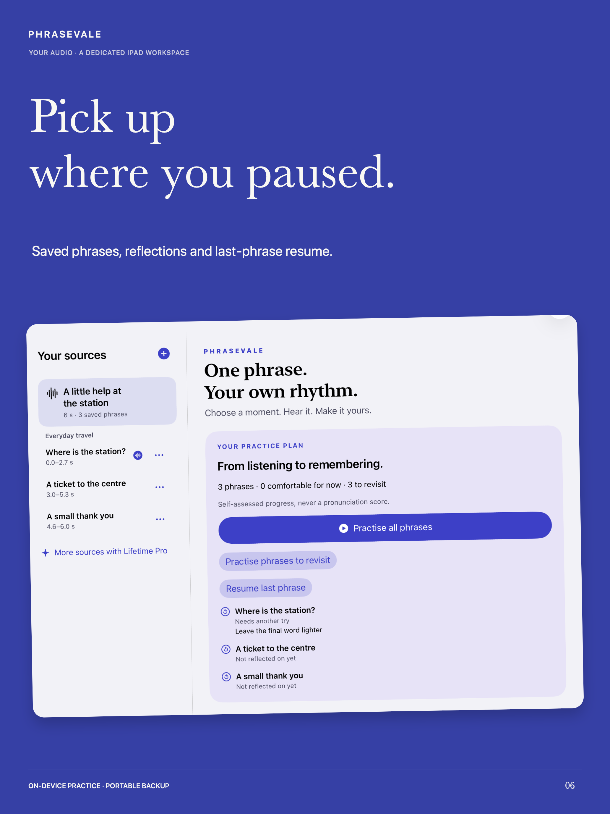 

The campaign uses actual native UI and illustrative practice with original-text audio rendered locally. No private recording or commercial source is published.

## Engineering and honest readiness

SwiftUI, AVFoundation/AVAudioSession, StoreKit2 and protected local files. Saved phrases retain decoded source positions; native playback completion drives speaking pauses. Atomic validation protects media and new personal reflection/resume metadata. Previous schema1 libraries and backups remain readable. Changing a phrase's region invalidates its old response and self-assessment; renaming preserves them.

Scoped iOS17 and26.5 native checks cover storage/recovery, audio completion/cancellation, learner session journeys and local StoreKit behavior. Final dated outcomes and remaining checks are maintained in the private production evidence. These checks overlap and are not a claim of exhaustive coverage or genuine Sandbox purchase success. Current physical microphone/routes/offline and spoken VoiceOver checks remain unverified; historical build1 hardware proof is not candidate2 proof. Actual iOS15 runtime is unavailable. TestFlight and remaining genuine Sandbox are publisher-SKIPPED, never passed.

The rejected build1's original Apple validation is historical. Local packaging of candidate2 does not establish Apple server validation, upload or resubmission. These product changes do not prove market originality or resolution of4.3(a). Metadata and reviewer walkthrough remain drafts until the candidate is genuinely ready.

[Product case study](https://sepidehdalir.github.io/phrasevale-showcase/) · [iOS portfolio](https://github.com/sepidehdalir/ios-app-portfolio)
