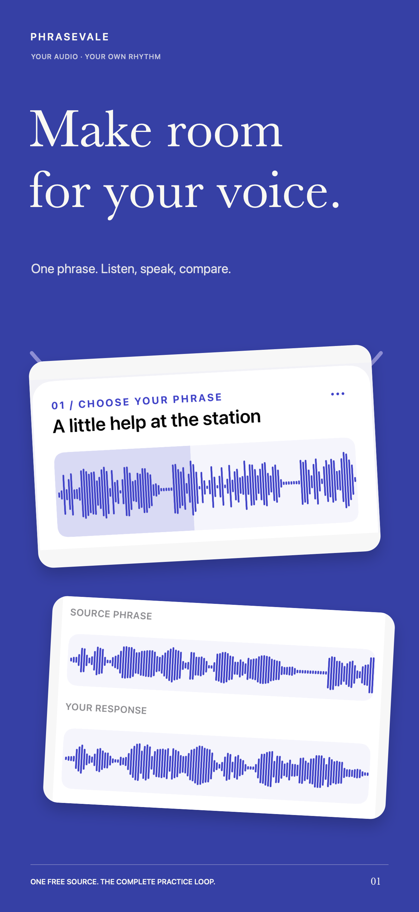
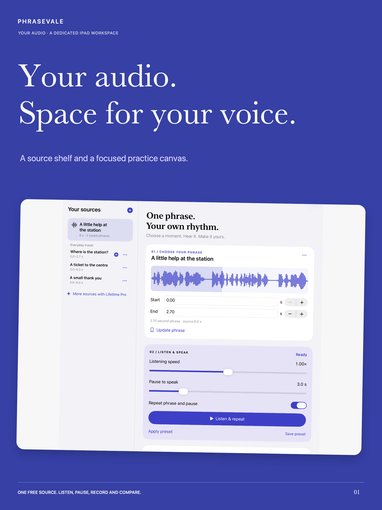
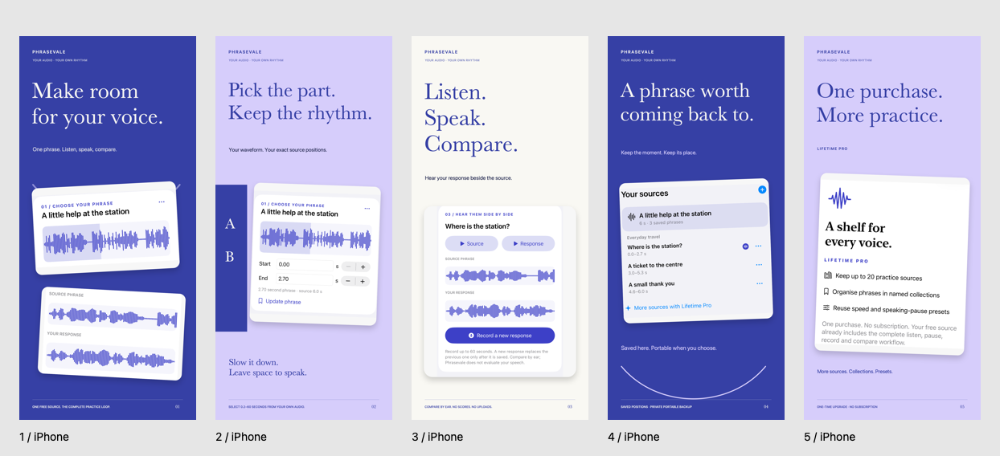
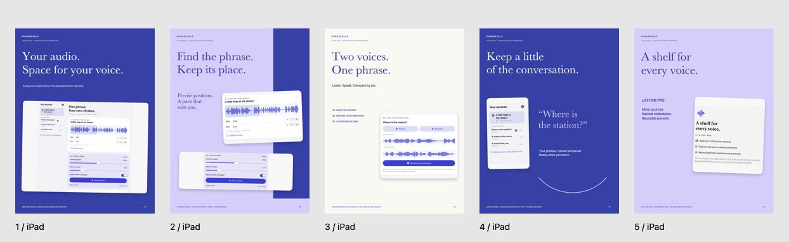

# Phrasevale — Audio Shadowing

**Development · not submitted or released.** Consumer name remains provisional pending App Store Connect reservation. Built by **Sepideh Javanbakht Dalir**.

Practise one phrase at a time from audio you own. Select a source region, listen at your pace, leave a speaking gap, record a response, then switch between the source and your response to compare by ear.

 

## Product

- Local Files import with a waveform and numeric source positions.
- Adjustable listening speed and speaking pause, with repeating practice.
- A response paired with each saved phrase; no transcription, scoring or learning guarantees.
- Saved phrases and named collections, reusable presets and validated portable recovery.
- Universal iPhone/iPad15+ with a dedicated tablet source shelf.

One useful source includes the full practice loop. A one-time Lifetime Pro upgrade adds multiple sources, named collections and saved presets. No subscription. The real in-app price comes from StoreKit.

## A distinct engineering problem

The central model is imported source audio, stable decoded regions and paired responses. AVAudioPlayerNode schedules source frame positions; AVAudioUnitTimePitch adjusts listening speed without changing pitch. The speaking pause starts after audio completion. Cancellation generations protect microphone permission and stale audio callbacks. Media-service resets rebuild the audio graph.

Persistence uses immutable UUID media and an atomic manifest. Backups include originals and responses only after explicit user action. Restore validates names, size, references and real decoded metadata in staging before replacing the library; failures preserve committed data.

SwiftUI, Swift concurrency, AVFoundation, AVAudioSession, Files and StoreKit2. No product backend, external AI, accounts, analytics SDK or third-party runtime dependencies. Commercial source is backed up in a separate private repository.

## Verification and limits

Twenty-one local core and StoreKit checks passed on the iOS17 simulator, including decoded region bounds, long-source handling, atomic recovery, permission cancellation, a controlled blocked-start timeout, verified local purchase/restore/refund, pending, cancellation and offline entitlement behavior. Native capture flows passed on current iPhone/iPad simulators. Corrected maximum-Dynamic-Type dark layouts passed portrait/landscape checks on compact iPhone and iPad and were visually inspected.

These are local simulator and Xcode StoreKitTest results. They do not establish genuine Sandbox purchases or physical microphone/headphone/interruption behavior. An initial iOS17 simulator input test failed with host HAL startup errors and remains preserved in the engineering history. After the serial audio-worker refactor, actual recorder/decoded-file/response-playback integration passed on both iOS17.0 and iOS26.5 simulators. These passes are measured test results; physical recording remains a separate gate.

An unsigned Universal iOS15 Release archive compiled with Xcode26.5. An iOS15 runtime was unavailable. Physical microphone/headphone/interruption checks, genuine Sandbox, signed archive validation, upload and review submission remain open. Apple account access and an explicit IAP-capable signing profile are required. TestFlight is skipped by publisher instruction.

The visuals show the actual native app with documented original-text demo audio rendered locally. No speaker's private recording or third-party lesson is published. This portfolio is development evidence, not proof of learning outcomes, customer demand or App Store approval.

## Campaign

### iPhone

### iPad

[Full campaign and project overview](https://sepidehdalir.github.io/phrasevale-showcase/) · [Support](https://sepidehdalir.github.io/phrasevale-showcase/support.html) · [Privacy](https://sepidehdalir.github.io/phrasevale-showcase/privacy.html)

[www.arvinify.com](https://www.arvinify.com) · [hello@arvinify.com](mailto:hello@arvinify.com)

